# Research and demo gallery

[← Profile](README.md) · [Research details](RESEARCH.md)

Actual application captures, source architecture figures and whole-page handwritten-note previews. The MP4s and GIFs are edited sequences of captured screen states; they are not continuous screen recordings or latency measurements. The still screenshots are preserved as captured.

## Application walkthroughs

| Application | Animated preview | MP4 |
| :--- | :--- | :--- |
| Brain MRI XAI | [GIF](assets/animations/brain-walkthrough.gif) | [Watch or download](assets/videos/brain-walkthrough.mp4) |
| AQUAGUARD microscopy prototype | [GIF](assets/animations/aquaguard-walkthrough.gif) | [Watch or download](assets/videos/aquaguard-walkthrough.mp4) |

On GitHub, GIF previews display inside the README. MP4 links open the repository's file view; use its raw/download option if a player is not shown.

### Brain MRI XAI Dashboard

[Open live Space](https://huggingface.co/spaces/Meraj-21/Brain-Tumor-Classification-Using-Grad-CAM)

A public example bundled with the Space (`static/uploads/Te-gl_0048.png`) was uploaded through the interface. The application returned a Glioma prediction and base-model Grad-CAM images. The displayed 96.60% is this sample's model confidence, not dataset accuracy or independently measured clinical performance.

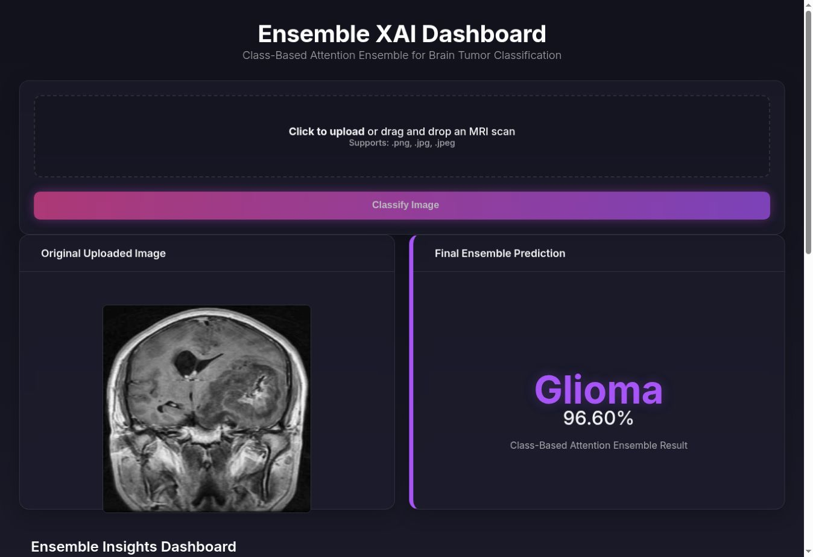

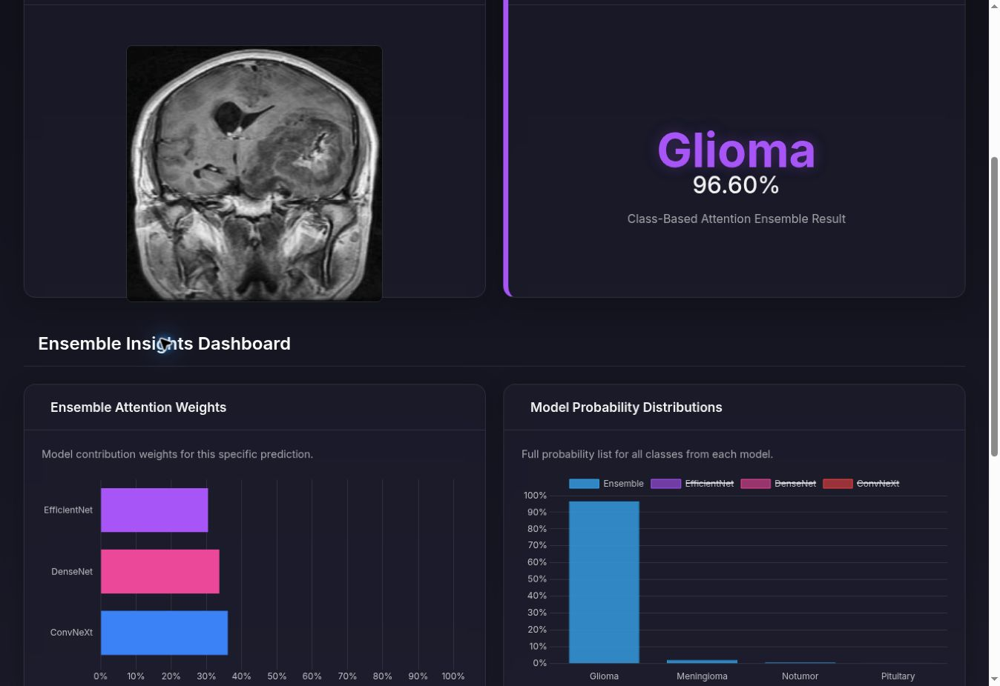

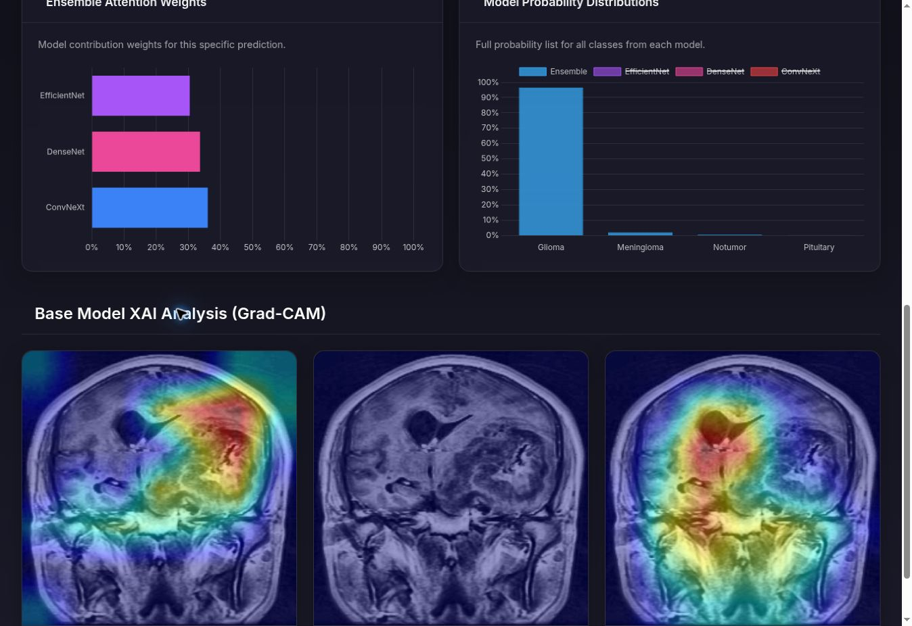

### AQUAGUARD

[Open live Space](https://huggingface.co/spaces/Meraj-21/AQUAGUARD)

Built-in **Example 1** was loaded with the application's preprocessed-image setting. The app returned a Parasitized prediction, heatmap and overlay. The displayed 99.9% is this sample's model confidence.

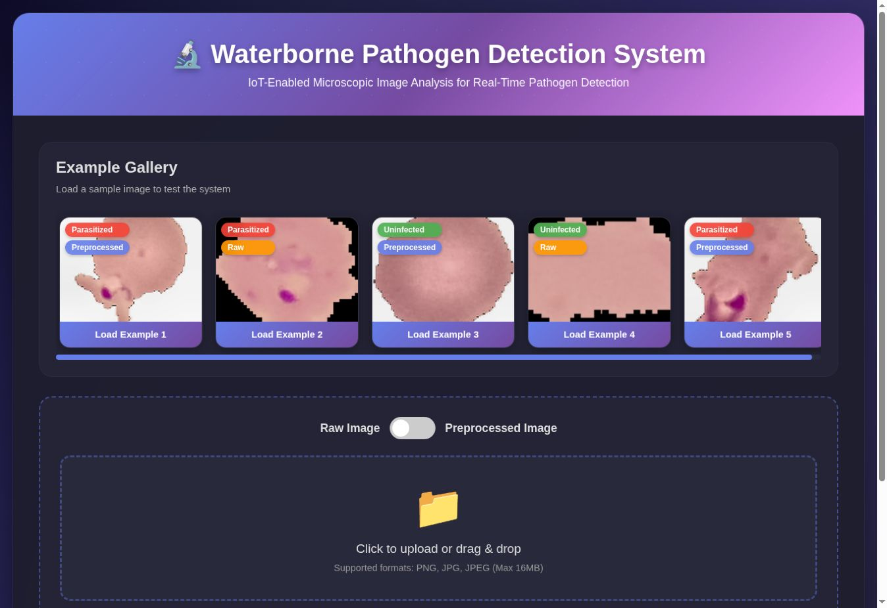

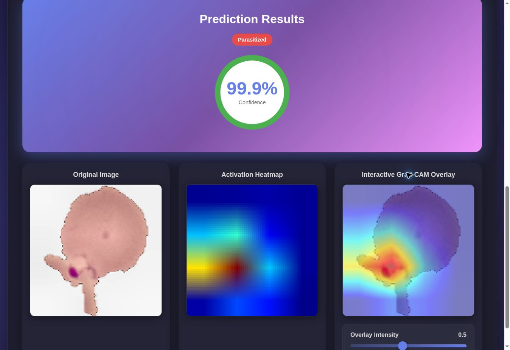

The screenshot retains the app's existing waterborne-pathogen and IoT branding. The portfolio description uses the narrower microscopy-prototype description because this capture does not establish waterborne-pathogen validation or an IoT integration.

### Rose Leaf Disease Detection

[Open live Space](https://huggingface.co/spaces/Meraj-21/Rose-Leaf-Disease-Detection)

This capture shows the actual upload/inference interface before an image was submitted. It is an interface preview, not a successful inference capture. A representative leaf sample can be used for a result walkthrough in a later update.

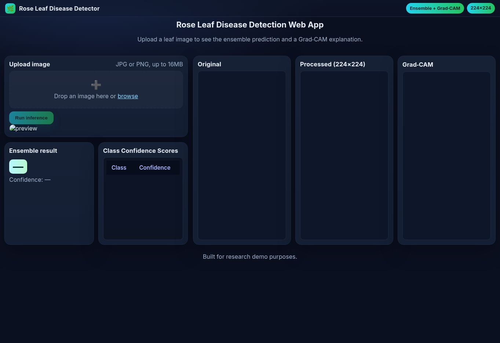

## Research architectures

### CAE-BrainNet

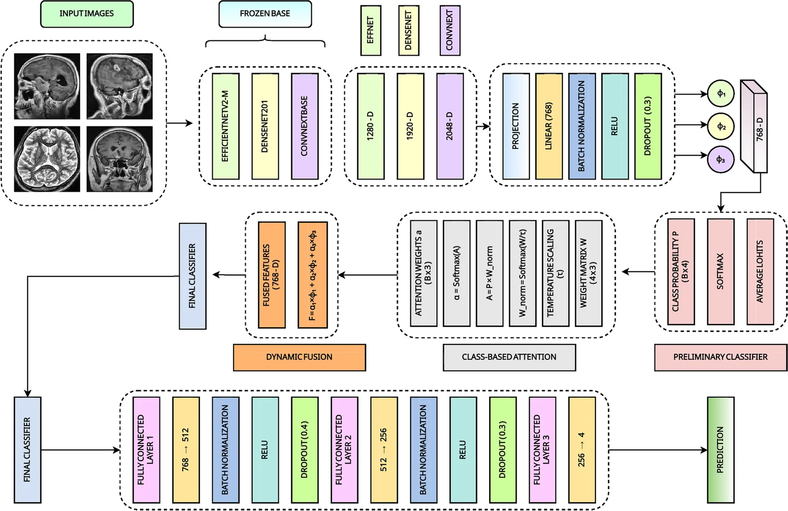

Meraj et al., **Brain Informatics (2026)**, Fig. 6. Figure reproduced unchanged from the [published article](https://pmc.ncbi.nlm.nih.gov/articles/PMC13534405/). © The Author(s), 2026. [CC BY-NC-ND 4.0](https://creativecommons.org/licenses/by-nc-nd/4.0/).

### CHASM

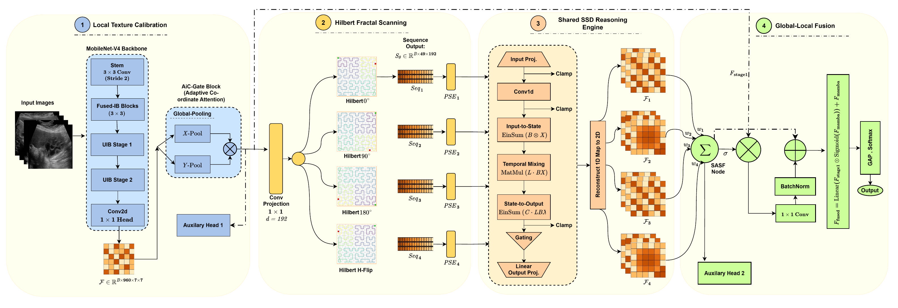

Figure copied unchanged from the author's [CHASM repository](https://github.com/Meraj-coding21/CHASM-Linear-Time-Hilbert-State-Space-Model/blob/main/assets/Proposed-Model.png).

### CEDD-Stack: example explainability output

| Original retinal image | DenseNet169 Grad-CAM overlay |
| :---: | :---: |
| 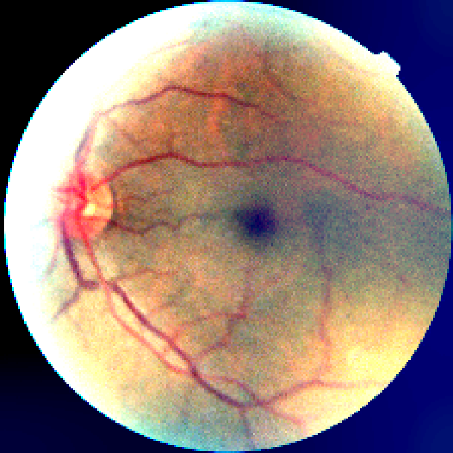 | 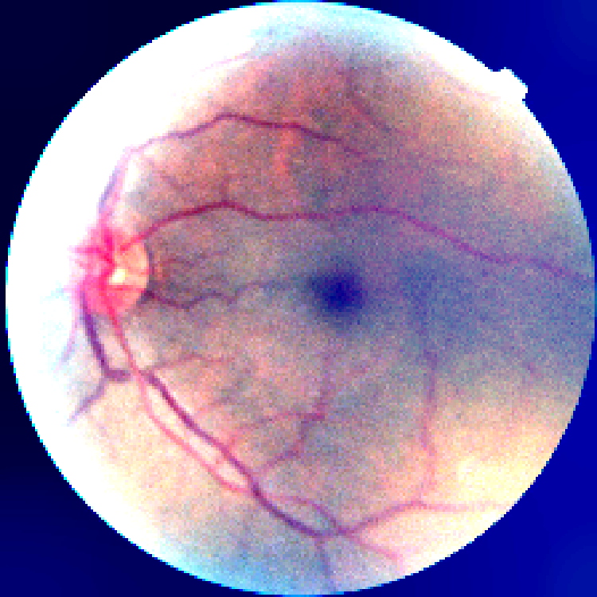 |

Existing example files from the [CEDD-Stack repository](https://github.com/Meraj-coding21/CEDD-Stack/tree/main/results/grad-cam), using the matching `04_class0_pred0` original/overlay pair. These are archived project outputs; they were not generated by a new evaluation during portfolio preparation.

## Handwritten-note previews

### LSTM gates

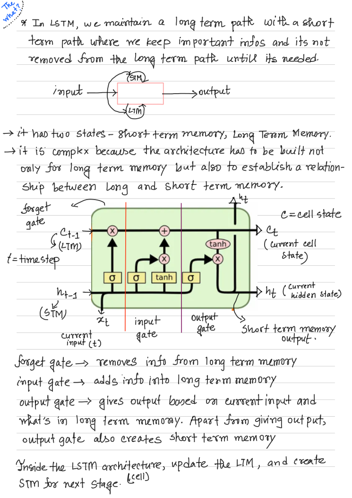

Source: `LSTM, GRU.pdf`, PDF page 1. [Open organized notes](https://github.com/Meraj-coding21/Deep-Learning-Handwritten-Notes/blob/main/notes/03-recurrent-networks/02-lstm-and-gru.pdf).

### CNN convolution

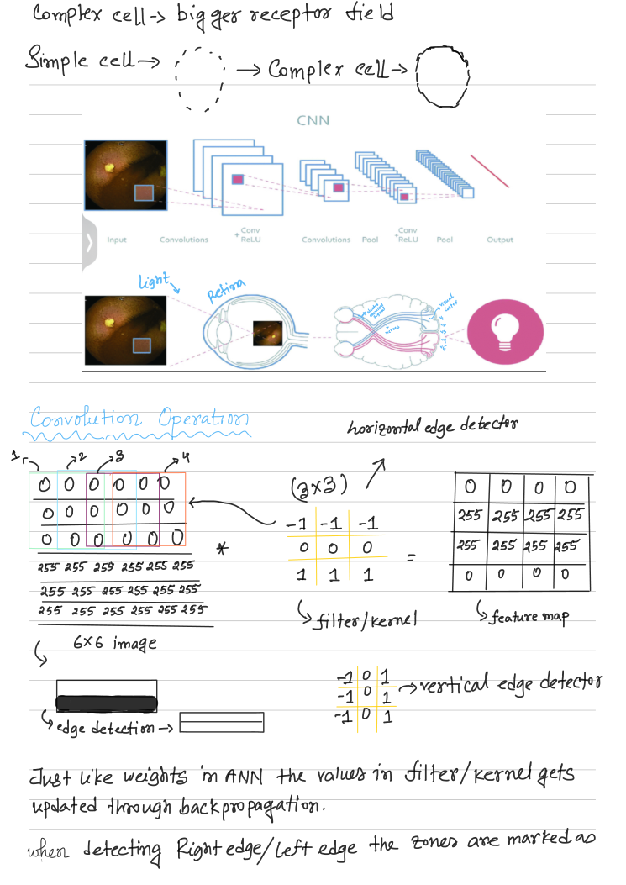

Source: `PART I.pdf`, PDF page 3. [Open organized notes](https://github.com/Meraj-coding21/Deep-Learning-Handwritten-Notes/blob/main/notes/02-cnns/01-cnn-foundations.pdf).

### Sinusoidal positional encoding

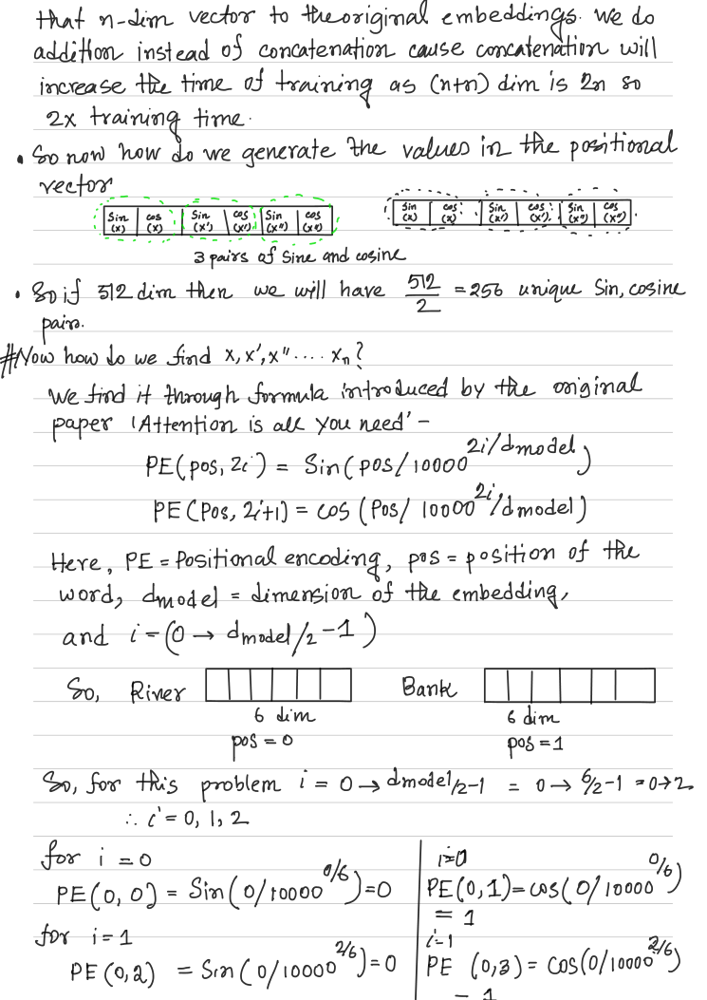

Source: `Attention, PE.pdf`, PDF page 9. [Open organized notes](https://github.com/Meraj-coding21/Deep-Learning-Handwritten-Notes/blob/main/notes/05-transformers/01-scaled-attention-multihead-and-position.pdf).

The previews render whole PDF pages without rewriting the handwritten material. The notes repository includes a separate clarification guide.
