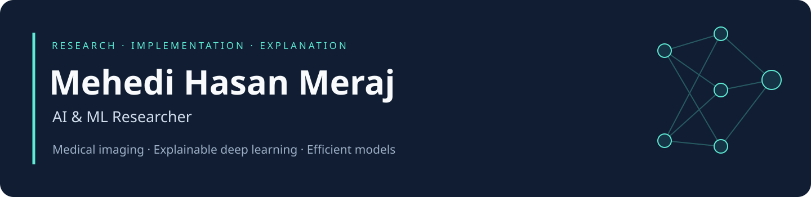
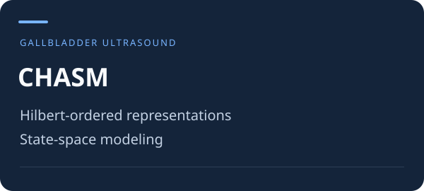
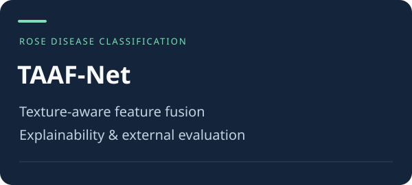
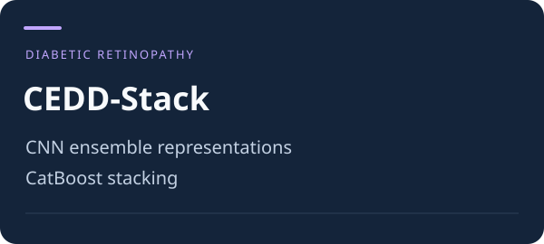
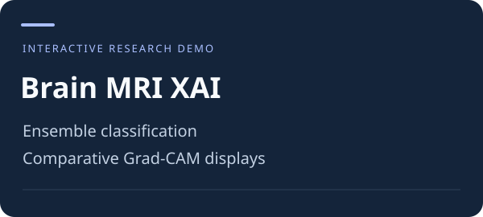
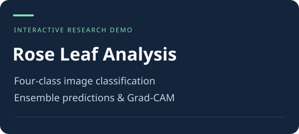
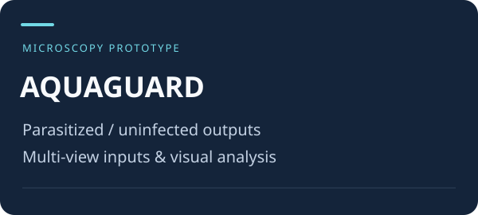

**[Research](#research) · [Implementations](#selected-research-implementations) · [AI demos](#interactive-ai-demos) · [Teaching](#teaching-and-learning) · [Connect](#connect)**

I am **Mehedi Hasan Meraj**, a Computer Science undergraduate at **Daffodil International University** and a **Research Associate at MARS Lab, DIU**. My work focuses on medical image analysis, explainable deep learning, ensemble methods and efficient sequence models.

I work across model design, preprocessing, experimentation, ablation studies, statistical evaluation and manuscript development. I also build interactive demonstrations and document the mathematics behind neural networks through handwritten notes and NumPy implementations.

**B.Sc. CSE in progress · CGPA 3.98/4.00 · Erasmus+ KA171 Exchange Scholar**

## Research

| Work | Research focus | Authorship and status |
| :--- | :--- | :--- |
| **[CAE-BrainNet](https://doi.org/10.1186/s40708-026-00325-x)** | Statistically validated class-adaptive attention ensemble for explainable brain tumor classification from MRI | **First author · Published · Brain Informatics, 2026** |
| **TriG-Net** | Segmentation-guided multi-branch glioma framework connecting segmentation, MGMT methylation prediction and survival estimation | **First author · Accepted · BioData Mining** |

My wider research includes gallbladder ultrasound classification, diabetic retinopathy grading, texture-aware disease recognition and ECG arrhythmia classification. Selected manuscripts are under review or revision.

**[Read more about my research →](RESEARCH.md)**

## Selected research implementations

<table>
<tr>
<td width="33%" valign="top"></td>
<td width="33%" valign="top"></td>
<td width="33%" valign="top"></td>
</tr>
<tr>
<td valign="top">Spatial ordering and efficient sequence modeling, with preprocessing, training and evaluation workflows.  <a href="https://github.com/Meraj-coding21/CHASM-Linear-Time-Hilbert-State-Space-Model"><strong>Explore CHASM →</strong></a></td>
<td valign="top">Deep representations combined with texture descriptors, gated fusion, explainability and external evaluation.  <a href="https://github.com/Meraj-coding21/TAAF-Net"><strong>Explore TAAF-Net →</strong></a></td>
<td valign="top">CNN predictions and a CatBoost stacking stage for five-class diabetic retinopathy severity grading.  <a href="https://github.com/Meraj-coding21/CEDD-Stack"><strong>Explore CEDD-Stack →</strong></a></td>
</tr>
</table>

## Interactive AI demos

These research demonstrations connect model inference with preprocessing, comparative predictions and visual explanations.

<table>
<tr>
<td width="33%" valign="top"></td>
<td width="33%" valign="top"></td>
<td width="33%" valign="top"></td>
</tr>
<tr>
<td valign="top"><strong>Brain MRI XAI Dashboard</strong> Four-class classification, an attention-based ensemble and Grad-CAM displays for the base models.  <a href="https://huggingface.co/spaces/Meraj-21/Brain-Tumor-Classification-Using-Grad-CAM"><strong>Try the demo →</strong></a></td>
<td valign="top"><strong>Rose Leaf Disease Detection</strong> Four-class leaf analysis with ensemble predictions and comparative Grad-CAM visualizations.  <a href="https://huggingface.co/spaces/Meraj-21/Rose-Leaf-Disease-Detection"><strong>Try the demo →</strong></a></td>
<td valign="top"><strong>AQUAGUARD</strong> A microscopy classification prototype with parasitized/uninfected outputs, multi-view inputs and interactive visual analysis.  <a href="https://huggingface.co/spaces/Meraj-21/AQUAGUARD"><strong>Explore the prototype →</strong></a></td>
</tr>
</table>

The rose demo and TAAF-Net are related projects with distinct model pipelines. Medical-image demonstrations are intended for research and education.

## Teaching and learning

I document concepts through **visual explanations, worked mathematics and code**. These resources show my approach to making deep learning easier to follow.

| Resource | What is inside |
| :--- | :--- |
| **[Deep Learning Handwritten Notes](https://github.com/Meraj-coding21/Deep-Learning-Handwritten-Notes)** | **115 pages across 13 PDFs** covering MLPs, ANN training, CNNs, RNNs, LSTMs, GRUs, attention and Transformers, with study and teaching guides |
| **[Neural Network From Scratch](https://github.com/Meraj-coding21/Neural-Network-From-Scratch)** | **18 NumPy notebooks** covering neurons, forward/backward propagation, losses, optimizers and regularization, paired with handwritten notes |
| **[PyTorch Basics](https://github.com/Meraj-coding21/Pytorch-Basics)** | Learning notebooks on autograd, training pipelines, datasets/loaders, neural architectures and transfer learning |

## Background

- **Research Associate, MARS Lab, DIU** — June 2025–present; medical AI research, experimentation, evaluation and manuscript development.
- **Research Assistant, SkillChefs** — November 2025–February 2026; machine-learning development, preprocessing, feature engineering and documentation.
- **Erasmus+ KA171 Exchange Scholar, Haliç University, Türkiye** — Fall 2024–25; exchange CGPA **3.92/4.00**.
- **Daffodil International University** — B.Sc. in Computer Science & Engineering, in progress; CGPA **3.98/4.00** and **two Dean’s List awards**.

## Technical toolkit

| Area | Tools and methods |
| :--- | :--- |
| Model development | Python, PyTorch, TensorFlow/Keras, scikit-learn, CatBoost, NumPy |
| Computer vision | OpenCV, CNNs, Transformers, ensemble learning, preprocessing and explainable AI |
| Research evaluation | Cross-validation, ablations, bootstrap confidence intervals, significance testing and external validation |
| Applications and workflow | Flask, FastAPI, Docker, Git/GitHub, pandas, Matplotlib and LaTeX |

## Connect

I am interested in **AI/ML research opportunities, research collaborations and practical AI teaching**.

**[LinkedIn](https://www.linkedin.com/in/mehedi-meraj) · [Hugging Face](https://huggingface.co/Meraj-21) · [Email](mailto:meraj23105101318@diu.edu.bd)**
