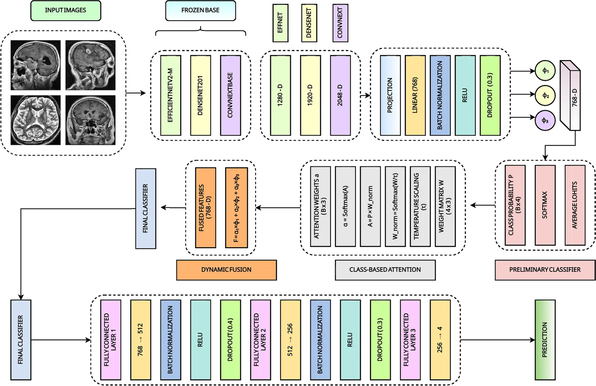
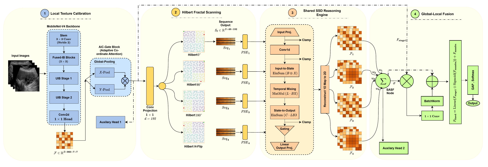

# Research profile

[← Profile overview](README.md)

My research focuses on medical-image classification, multimodal glioma analysis, explainable deep learning, ensemble methods and efficient sequence modeling. I am interested in connecting architectural ideas with careful evaluation: what improves, how consistently it improves, how it behaves on external data and what its predictions reveal.

## Published work

### CAE-BrainNet

**CAE-BrainNet: a statistically validated class-adaptive attention ensemble model for explainable brain tumor classification from MRI**

**First author · Brain Informatics · Published, 2026**

[Read the paper](https://doi.org/10.1186/s40708-026-00325-x)

The work studies a class-adaptive attention ensemble for MRI-based brain tumor classification, with statistical validation and explainability. It reflects my interest in combining complementary model representations and assessing the resulting classifier beyond a single headline metric.

**Authors:** Mehedi Hasan Meraj, Mashfiquzzaman Tajbid, Mayen Uddin Mojumdar, Narayan Ranjan Chakraborty, Mohammaed Jabed Morshed Chowdhury and Kamanashis Biswas.

**DOI:** `10.1186/s40708-026-00325-x`

*Published Fig. 6, reproduced unchanged. © The Author(s), 2026. [Source article](https://pmc.ncbi.nlm.nih.gov/articles/PMC13534405/) · [CC BY-NC-ND 4.0](https://creativecommons.org/licenses/by-nc-nd/4.0/).*

[Explore the demo captures and walkthroughs →](MEDIA.md)

## Accepted work

### TriG-Net

**First author · Accepted in BioData Mining**

A segmentation-guided multi-branch glioma framework connecting tumor segmentation, MGMT methylation prediction and survival estimation. This work extends my research from classification toward a connected set of imaging and outcome-prediction tasks.

Accepted status is stated separately from published work. A publication link can be added when the final article record becomes available.

## Selected research implementations

### CHASM · Gallbladder ultrasound classification

[Repository](https://github.com/Meraj-coding21/CHASM-Linear-Time-Hilbert-State-Space-Model)

CHASM investigates Hilbert-ordered spatial representations and state-space modeling for gallbladder ultrasound classification. The repository documents preprocessing, training, evaluation, a perceptual-hash split workflow and checkpoint checks.

*Architecture figure from the CHASM project repository.*

**Research emphasis:** spatial ordering, efficient sequence processing, auxiliary training components and reproducible evaluation.

### TAAF-Net · Fine-grained rose disease classification

[Repository](https://github.com/Meraj-coding21/TAAF-Net)

TAAF-Net combines deep representations with LBP/GLCM texture descriptors and gated fusion. Its repository includes training and independent-test workflows, cross-validation, statistical analysis, explainability and external evaluation.

**Research emphasis:** complementary visual representations, texture-aware fusion and generalization to external images.

The deployed [rose leaf application](https://huggingface.co/spaces/Meraj-21/Rose-Leaf-Disease-Detection) uses a distinct ensemble pipeline. It should not be interpreted as a verified deployment of the exact TAAF-Net research architecture.

### CEDD-Stack · Diabetic retinopathy grading

[Repository](https://github.com/Meraj-coding21/CEDD-Stack)

CEDD-Stack combines CNN-based predictions with CatBoost stacking for five-class diabetic retinopathy severity grading. The repository documents preprocessing, model training, evaluation and explainability workflows.

**Research emphasis:** complementary base learners, ensemble construction and retinal-image analysis.

## Additional manuscript work

The following lines of work are under review or revision and are not listed as accepted publications:

| Work | Topic | Journal named in my current research CV |
| :--- | :--- | :--- |
| CHASM | Gallbladder ultrasound and Hilbert state-space modeling | Scientific Reports |
| CNN–CatBoost stacking / CEDD-Stack | Diabetic retinopathy grading | Biomedical Signal Processing and Control |
| TAAF-Net | Texture-aware attention fusion for rose disease classification | Complex & Intelligent Systems |
| HiMTAN | ECG arrhythmia classification | Scientific Reports |

## How I approach evaluation

Depending on the task, my work includes:

- Independent held-out evaluation and cross-validation.
- Ablations that isolate the contributions of model components.
- Bootstrap confidence intervals and significance testing.
- External validation and transfer evaluation.
- Explainability visualizations interpreted alongside quantitative results.
- Clear separation of reported manuscript results from newly reproduced experiments.

Individual repositories provide the task-specific protocols and reported results. This profile does not treat results from different datasets or splits as directly comparable benchmarks.

## Research experience

**Research Associate · MARS Lab, Daffodil International University · June 2025–present**

Medical AI work spanning brain MRI, glioma analysis, gallbladder ultrasound, diabetic retinopathy and ECG classification. Activities include model design, experimentation, evaluation, explainability, statistical analysis and manuscript development.

**Research Assistant · SkillChefs · November 2025–February 2026**

Machine-learning development and evaluation, including preprocessing, feature engineering, training and technical documentation.

## Academic background

**B.Sc. in Computer Science & Engineering, Daffodil International University** — in progress; CGPA **3.98/4.00**, two Dean’s List awards.

**Erasmus+ KA171 exchange, Haliç University, Türkiye** — Fall 2024–25; exchange CGPA **3.92/4.00**. Coursework included AI, Machine Learning and Object-Oriented Programming.

## Collaboration

I welcome discussions about medical-image analysis, explainable models, ensemble learning and efficient architectures.

[LinkedIn](https://www.linkedin.com/in/mehedi-meraj) · [Email](mailto:meraj23105101318@diu.edu.bd)
